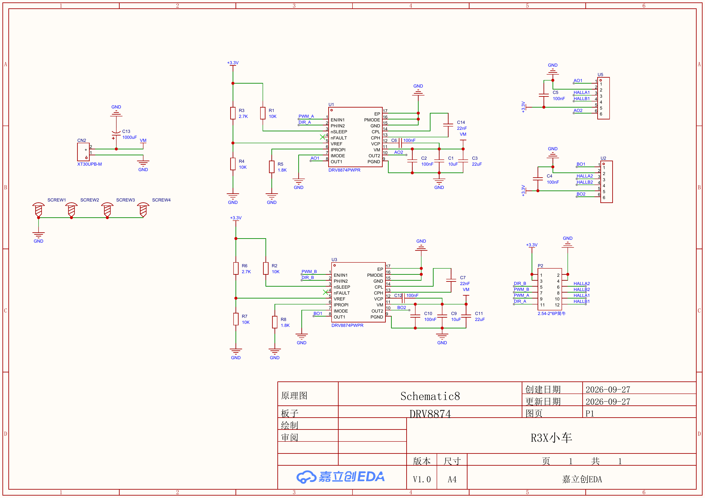
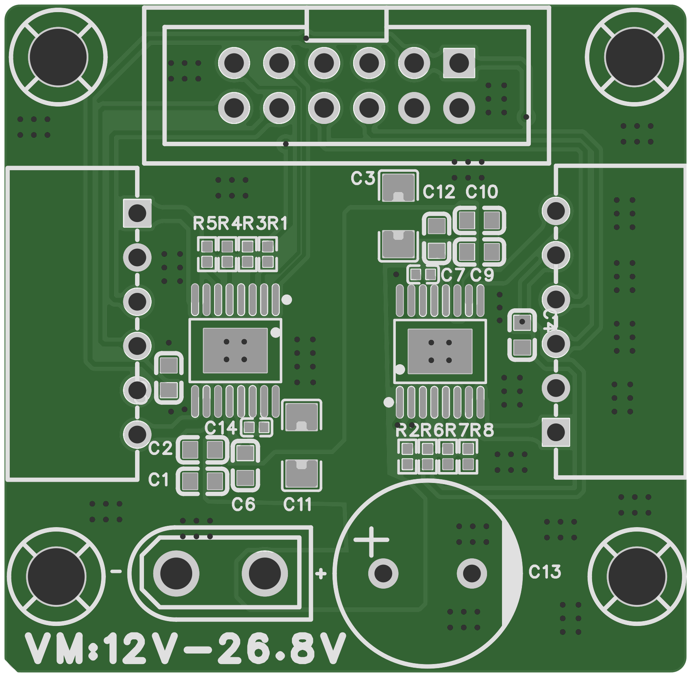

# DRV8874 双路电机驱动模块

面向电子设计竞赛、差速小车和机器人实验的双路有刷直流电机驱动模块。采用两颗 DRV8874PWPR，每路使用一根 PWM 信号和一根方向信号，提供两组带编码器信号的六针电机接口。

> 当前资料根据 2026-09-27 导出的 V1.0 原理图、BOM 和 Gerber 整理。已包含生产文件，尚缺可编辑 EDA 工程与实物测试记录。限流值为理论计算值，供电范围及持续电流额定值待验证。





PCB 预览由 Gerber 渲染，展示裸板焊盘、走线与丝印；配色仅用于展示。底面见 [PCB 底面预览](docs/images/pcb-bottom.png)。

## 1. 硬件概览

| 项目 | 原理图配置 |
| --- | --- |
| 电机通道 | A、B 两路独立的有刷直流电机全桥 |
| 驱动芯片 | U1、U3：DRV8874PWPR |
| 控制接口 | 每路 PWM + DIR；PMODE 接地，配置为 PH/EN 模式 |
| 限流方式 | IMODE 接地，固定关断时间斩波；过流故障自动重试 |
| 每路限流阈值 | 约 3.2 A，见下文计算；不是持续电流额定值 |
| 电机电源 | CN2：XT30UPB-M，接入 VM |
| 设计供电标注 | PCB 丝印为 VM:12V-26.8V；尚未由测试记录验证 |
| 逻辑与编码器电源 | 外部输入 3.3 V，板上未画出稳压器 |
| PCB | Gerber 提供顶/底两层铜，板框约 38.735 × 37.973 mm；板厚和铜厚待补 |
| 主控接口 | P2：2.54 mm、2×6 简牛 |
| 电机接口 | U5 对应 A 路，U2 对应 B 路，均为 ZX-XH2.54-6PWZ 六针连接器 |
| 编码器信号 | 两组 A/B 相信号直接连接主控接口 |
| 电源储能电容 | C13：1000 µF；每颗驱动附近另有 10 µF、22 µF、100 nF |

芯片的推荐 VM 范围为 4.5～37 V，峰值输出能力为 6 A；资料来源：[TI 产品页](https://www.ti.com/product/DRV8874)及[数据手册](https://www.ti.com/lit/ds/symlink/drv8874.pdf) §6.3。上述芯片指标不能直接当作本模块额定值。当前电路的限流阈值约为 3.2 A，PCB 丝印标注供电为 12～26.8 V。BOM 中 C13 的型号为 PA35V1000M10x15，额定耐压 35 V，VM 侧其他电容耐压尚未指定。C13 规格参见[供应商规格页](https://jlcpcb.com/partdetail/jieerrui-PA35V1000M10x15/C46550434)。正式供电范围仍需核对全部器件和实测瞬态。

## 2. 接口定义

以下编号均按原理图标注。实物接线应以连接器的 Pin 1 标识及 PCB 为准。

### P2 牛角座接口顺序表（主控接口）

P2 为 2.54 mm、2×6、12 针牛角座（简牛）。以下按引脚编号 1～12 排列，信号方向以驱动模块为参照。

| 引脚编号 | 信号名称 | 信号方向 | 功能说明 |
| --- | --- | --- | --- |
| 1 | +3.3V | 电源输入 | 外部 3.3 V 逻辑与编码器电源 |
| 2 | GND | 公共地 | 与主控及电机电源共地 |
| 3 | +3.3V | 电源输入 | 与 Pin 1 并联 |
| 4 | GND | 公共地 | 与 Pin 2 并联 |
| 5 | DIR_B | 主控 → 模块 | B 路电机方向控制，连接 U3 的 PH/IN2 |
| 6 | HALLA2 | 编码器 → 主控 | B 路编码器 A 相信号透传 |
| 7 | PWM_B | 主控 → 模块 | B 路电机 PWM 调速，连接 U3 的 EN/IN1 |
| 8 | HALLB2 | 编码器 → 主控 | B 路编码器 B 相信号透传 |
| 9 | PWM_A | 主控 → 模块 | A 路电机 PWM 调速，连接 U1 的 EN/IN1 |
| 10 | HALLA1 | 编码器 → 主控 | A 路编码器 A 相信号透传 |
| 11 | DIR_A | 主控 → 模块 | A 路电机方向控制，连接 U1 的 PH/IN2 |
| 12 | HALLB1 | 编码器 → 主控 | A 路编码器 B 相信号透传 |

相邻引脚配对为 1/2、3/4、5/6、7/8、9/10、11/12。插接排线时，应根据实物 Pin 1 标识和连接器方向确认编号。

Pin 1 与 Pin 3 在板内并联，Pin 2 与 Pin 4 在板内并联。+3.3V 是外部电源输入，并为两组编码器接口提供电源。

### 六针电机接口

| 脚号 | A 路：U5 | B 路：U2 | 用途 |
| --- | --- | --- | --- |
| 1 | AO1 | BO1 | 电机端子 OUT1 |
| 2 | GND | GND | 编码器地 |
| 3 | HALLA1 | HALLA2 | 编码器 A 相 |
| 4 | HALLB1 | HALLB2 | 编码器 B 相 |
| 5 | +3.3V | +3.3V | 编码器电源 |
| 6 | AO2 | BO2 | 电机端子 OUT2 |

电机绕组接在 Pin 1 与 Pin 6 之间。Pin 2 是编码器地，不是电机的另一端。BOM 中连接器型号为 ZX-XH2.54-6PWZ，封装名标注 P2.50；应按供应商图纸核对配套线束与额定电流。

### CN2 电机电源

| 脚号 | 网络 | 极性 |
| --- | --- | --- |
| 1 | GND | 负极 |
| 2 | VM | 正极 |

主控、3.3 V 电源和 VM 电源共地。原理图未画出反接保护电路。

## 3. 电机控制

两路 PMODE 接地，因此使用 PH/EN 控制。PWM_A/B 接芯片 EN，DIR_A/B 接芯片 PH。两路 nSLEEP 分别经 R1、R2（10 kΩ）上拉到 3.3 V，未引出主控控制。

正常唤醒且无故障时，控制关系如下：

| PWM / EN | DIR / PH | OUT1 | OUT2 | 状态 |
| --- | --- | --- | --- | --- |
| 0 | 任意 | 低 | 低 | 刹车，低侧慢衰减 |
| 1 | 0 | 低 | 高 | 驱动方向一 |
| 1 | 1 | 高 | 低 | 驱动方向二 |

PWM 调速在驱动和刹车之间切换；0% 占空比对应刹车。机械正反方向由电机接线决定。当前主控接口未提供独立休眠/滑行控制。依据：[数据手册](https://www.ti.com/lit/ds/symlink/drv8874.pdf) §7.3.2.1、Table 3。

主控应先将 PWM 输出设置为低，再初始化方向和定时器，逐步增加占空比。换向前先将 PWM 降到零，并根据电机惯量和电流情况完成减速。具体 PWM 频率及换向时序应结合实物测试确定。

## 4. 限流配置

两路使用相同的限流网络：

| 功能 | A 路 | B 路 | 阻值 |
| --- | --- | --- | --- |
| VREF 分压上臂 | R3 | R6 | 2.7 kΩ |
| VREF 分压下臂 | R4 | R7 | 10 kΩ |
| IPROPI 对地电阻 | R5 | R8 | 1.8 kΩ |

按 3.3 V 电源和数据手册电气特性表的典型电流镜比例 450 µA/A 计算：

```text
VREF = 3.3 × 10 / (2.7 + 10) ≈ 2.598 V
ITRIP = VREF / (RIPROPI × AIPROPI)
      = 2.598 / (1800 × 450×10^-6) ≈ 3.21 A
```

这是触发内部斩波调节的理论阈值，受电源、电阻及芯片误差影响。它与短路过流保护阈值、模块持续输出电流额定值是不同参数。数据手册应用示例使用 455 µA/A 时算得约 3.17 A，二者均可概括为约 3.2 A。依据：[数据手册](https://www.ti.com/lit/ds/symlink/drv8874.pdf) §6.5、§7.3.3.2。

当前 IPROPI 仅接限流电阻，未连接主控 ADC；nFAULT 未连接。模块因此具备芯片内部限流和保护，但当前接口没有向主控提供电流反馈或驱动故障反馈。

## 5. 编码器连接

HALLA1/HALLB1 和 HALLA2/HALLB2 为直接透传的信号网络，板上未画出信号上拉或电平转换。编码器应支持 3.3 V 供电，输出电平应满足主控输入要求。开漏/开集电极输出需要合适的上拉；应先核对编码器和主控电路，再确定由哪一侧提供。

编码器译码、速度闭环和位置控制由主控软件实现，本仓库当前没有可验证的固件示例。

## 6. 仓库文件

```text
.
├── README.md
├── hardware/
│   ├── schematic.pdf       # 用户提供的原理图
│   ├── bom.xlsx            # 用户提供的原始BOM
│   └── gerber.zip          # 用户提供的原始生产文件包
└── docs/
    ├── hardware-review.md  # 原理图、BOM及Gerber核对记录
    ├── bom-summary.md      # BOM器件、封装与采购料号摘要
    ├── fabrication.md     # 板尺寸、生产文件清单与待补参数
    └── images/
        ├── schematic.png
        ├── pcb-top.png
        └── pcb-bottom.png
```

## 7. 发布前补充

- 嘉立创 EDA 原理图与 PCB 可编辑工程。
- 补全 BOM 中缺失的阻容采购料号、电容耐压/介质、精度及连接器额定电流。
- 板厚、铜厚、表面处理、清楚的接口丝印和实物照片。
- 单路/双路带载温升、连续电流、启动/堵转限流和供电瞬态测试记录。
- 对应主控的接线与可运行示例。

## 8. 开源许可证

本项目的原创硬件设计文件与文档采用 [MIT License](LICENSE)。版权署名为 ZiYuan32。使用或分发时须保留版权和许可证声明。外部参考资料及第三方内容遵循其原有授权。
