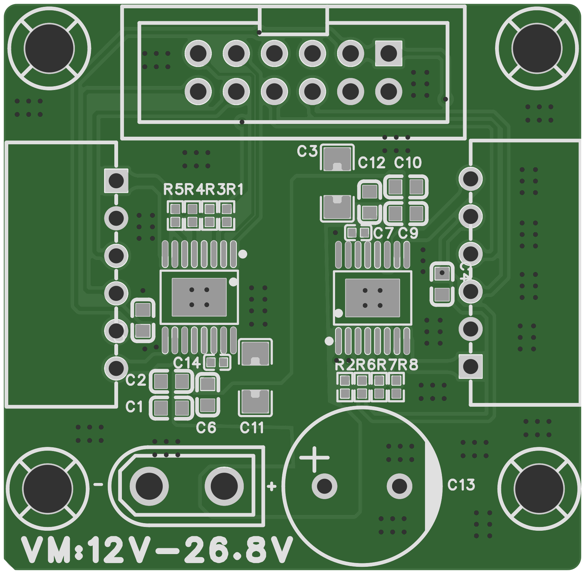
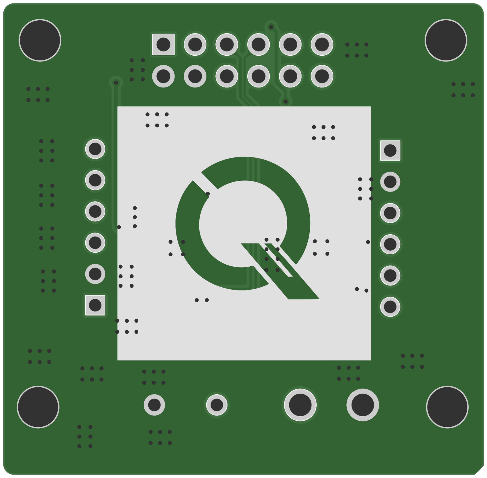

# PCB 与生产文件

生产文件：[hardware/gerber.zip](../hardware/gerber.zip)，原包文件名 `Gerber_PCB8_2026-09-27.zip`，由嘉立创 EDA Pro 导出。文件按原样保留。

## 几何与层信息

| 参数 | 当前资料 |
| --- | --- |
| 板框尺寸 | 约 38.735 × 37.973 mm（板框中心线尺寸，不含绘制线宽） |
| 圆角 | 约 R1 mm |
| 铜层 | 顶层、底层；未提供内层铜 |
| 元件面 | 飞针文件中的 BOM 器件坐标均为顶面 |
| 安装孔 | 4 个，钻孔直径约 3.2004 mm，图中连接 GND |
| 板厚、铜厚、表面处理 | 当前资料未注明 |
| 电机电源丝印 | VM:12V-26.8V，属设计标注，待实测验证 |

以上为 Gerber 渲染的裸板预览，配色不代表实际下单阻焊颜色。底面为从底面观察的视图。

## Gerber 包文件清单

| 文件 | 用途 |
| --- | --- |
| Gerber_TopLayer.GTL | 顶层铜 |
| Gerber_BottomLayer.GBL | 底层铜 |
| Gerber_TopSilkscreenLayer.GTO | 顶层丝印 |
| Gerber_BottomSilkscreenLayer.GBO | 底层丝印 |
| Gerber_TopSolderMaskLayer.GTS | 顶层阻焊开窗 |
| Gerber_BottomSolderMaskLayer.GBS | 底层阻焊开窗 |
| Gerber_TopPasteMaskLayer.GTP | 顶层钢网 |
| Gerber_BoardOutlineLayer.GKO | 板框 |
| Gerber_DocumentLayer.GDL | 辅助文档层 |
| Gerber_DrillDrawingLayer.GDD | 钻孔图 |
| Drill_PTH_Through.DRL | 镀通孔钻孔（包含过孔） |
| Drill_PTH_Through_Via.DRL | 过孔钻孔子集 |
| FlyingProbeTesting.json | 飞针测试网络和坐标数据 |
| PCB下单必读.txt | 导出工具附带的下单说明 |

两份 DRL 中有重合过孔坐标。制造端应按层用途识别这些文件，避免重复计入钻孔。当前资料包没有改写原始钻孔文件。

## 生产与装配待补

- 明确板厚、铜厚、阻焊颜色和表面处理，并确认生产商的文件识别结果。
- 提供完整阻容采购料号、可编辑 EDA 工程和需要的正式贴装坐标文件。
- EP 区域过孔应结合钢网、焊膏及制板工艺确认焊接质量。
- 补充完整 DRC/铜层连通性检查结果，以及带载温升和供电瞬态测试记录。

本记录确认文件可解析、几何及主要网络标签对应情况；不代表已经完成制板或性能验证。
